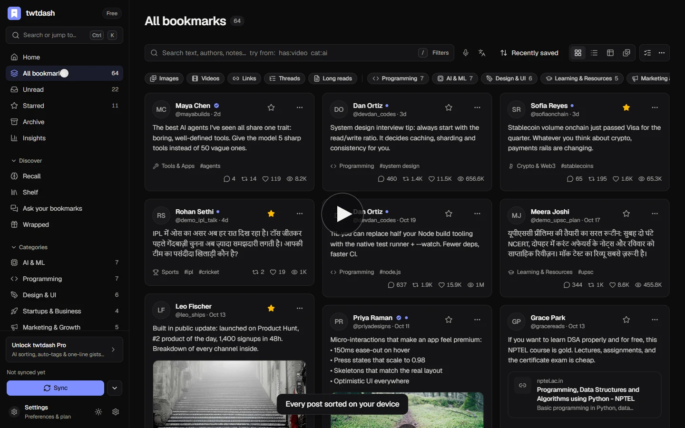
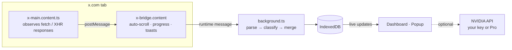

<div align="center">


# twtdash

**Your X bookmarks, organized.**

A fast, private library for everything you save on X. Posts are sorted on your device,<br />
searchable as you type, and easy to come back to. Built for India, in English, Hindi and eight more Indian languages.

[Website](https://twtdash.vercel.app) · [Install](#install) · [Watch the demo](docs/media/twtdash-demo.mp4) · [How sync works](#how-sync-works) · [Performance](PERFORMANCE.md)


</div>

<br />

<a href="docs/media/twtdash-demo.mp4"></a>
<p align="center"><sub><a href="docs/media/twtdash-demo.mp4">Play the one-minute demo</a></sub></p>

<br />

<picture>
  <source media="(prefers-color-scheme: dark)" srcset="docs/screenshots/library-dark.webp" />
  <source media="(prefers-color-scheme: light)" srcset="docs/screenshots/library-light.webp" />
  
</picture>

<br />

## Contents

[Why twtdash](#why-twtdash) · [Features](#features) · [Made for India](#made-for-india) · [Status](#status) · [Screenshots](#screenshots) · [Install](#install) · [How sync works](#how-sync-works) · [Search and shortcuts](#search-and-shortcuts) · [Privacy](#privacy-and-permissions) · [Performance](#performance) · [Pro and the hosted API](#pro-and-the-hosted-api) · [Development](#development) · [Known limitations](#known-limitations) · [License](#license)

## Why twtdash

X bookmarks turn into a pile you never open again: no real search, no folders unless you pay, no notes, and no way back to the thread you saved eight months ago. twtdash turns that pile into a library.

- **One click syncs everything.** No X API key, no paid developer plan, no account.
- **Every post is sorted on your device** into one of 18 categories the moment it arrives, including posts written in Hindi, Hinglish and other Indian languages.
- **Search as you type** across text, authors, notes, tags and link titles, with operators such as `from:`, `cat:`, `has:video` and `after:30d`.
- **Private by default.** The library lives in your browser. Nothing leaves it unless you turn on an AI feature.
- **Fast at 10,000+ posts.** Virtualized lists, streamed loading and a first screen in about a second. The numbers are in [PERFORMANCE.md](PERFORMANCE.md).

## Features

**Library.** Grid, list, table and media gallery layouts, all virtualized. Star, mark read, archive, add notes, tags and collections, and act on many posts at once. A detail panel shows the full post, your note, related posts and more from the same author. <kbd>Ctrl</kbd>/<kbd>⌘</kbd> <kbd>K</kbd> jumps to any post, category or screen.

**Sync and capture.** twtdash scrolls your bookmarks page and reads the data X already sends to your browser. Quick sync stops at posts you already have; full sync refreshes everything. Bookmark or like a post anywhere on X and it appears in twtdash immediately. X Premium bookmark folders become collections, and you can import your likes too.

**Categories.** Eighteen built-in categories are scored from the post text, link previews, quoted posts and linked sites. Romanized Hindi and Indian scripts count. Add keywords, create your own categories, or re-sort at any time; posts you sorted by hand are never overridden.

**Recall.** A short daily review that brings back saved posts on a spaced schedule, so the ones you're starting to forget resurface. Rate each post, keep a streak, and pick how many posts a day and from which categories.

**Shelf.** Every resource inside your saved posts, pulled out and grouped: repositories, papers, videos, articles, tools, books, courses, podcasts, docs, datasets and jobs. See who shared each one and export the shelf as Markdown.

**Ask your bookmarks.** Ask a question in English, Hindi or Hinglish. twtdash finds the matching posts on your device and an AI model answers from them, with numbered citations that open the original post. Without AI, Ask shows the matching posts.

**Wrapped.** A story-style recap of what you saved: totals, top categories and authors, when you save, your longest streak and a reading persona, ending in an image you can download or share.

**Insights.** Saves over time, your category mix, the authors you learn from most, content types and when you save, all within one date range.

**Voice and translation.** Speak your search or question in English (India) or ten Indian languages. Translate any post into Hindi, Hinglish or another Indian language.

**Export.** Markdown grouped by category (ready for Obsidian and Notion), Excel-safe CSV, or a full JSON backup you can merge back on any device.

Recall, Shelf, Wrapped, search and categories run entirely on your device. Ask, translation and AI sorting are optional: they use a free NVIDIA API key you paste in Settings, or twtdash Pro.

## Made for India

- **Hindi** across the core app (library, search, settings, insights, popup), in the everyday style of Indian consumer apps. Words people actually say, such as बुकमार्क and टैग, stay as they are. The newest screens (Recall, Shelf, Ask and Wrapped) are in English for now.
- **Bengali, Marathi, Telugu, Tamil, Gujarati, Kannada, Malayalam and Punjabi** in beta, covering the core interface with English for the rest. These still need review by native speakers.
- **Indian-language aware sorting.** Categories understand romanized Hindi (*naukri*, *nivesh*, *sarkari*) and keywords in Devanagari and other Indian scripts. A Sports category covers cricket, IPL and kabaddi.
- **Indian number formatting**: 1,23,456, with lakh and crore for large counts.
- **Rupee pricing** for Pro, detected from your region, with a ₹/$ switch.
- **Light on hardware.** Built to stay smooth on everyday laptops with large libraries.

## Status

As of October 28, 2026. Every row says how it was checked.

| Area | State | How it's checked |
|---|---|---|
| Sync from x.com | Working against a simulated x.com; not yet verified against a live X account | The real built extension runs in Chrome against a local x.com simulator: full and quick sync over fetch and XHR, rate-limit retry, live save and remove, logged-out handling, popup and console (13 checks, also passing on a deliberately loaded CPU) |
| Reading X's data | Working | Parser tests against recorded X responses, plus 2,700 fuzzed and malformed payloads that must never crash or store a bad value |
| Library, layouts, search and operators, detail panel, bulk actions, command palette | Working | 437 unit tests and 339 end-to-end browser checks (desktop, tablet and phone; dark and light) |
| Search in Indian scripts | Working | Hindi, Bengali, Tamil, Urdu and mixed-script queries; equivalent Unicode spellings match |
| Categories, including Hindi, Hinglish and Indian scripts | Working | Unit tests and a labeled evaluation set |
| Recall, Shelf, Wrapped | Working | Unit tests, property tests on empty to 5,000-post libraries, and browser checks |
| Export (Markdown, CSV, JSON) and re-import | Working | Exact JSON round trip; 13 malformed or hostile backup files are rejected without touching the library; CSV cells can't run as spreadsheet formulas |
| Upgrading from an earlier version | Working | A database from the previous version keeps every post, category, collection and index |
| Large libraries | Working | 10,000 and 50,000-post stress tests: first screen in about 1 s and 2 s |
| Memory | No leaks found | 400 screen visits on a 10,000-post library: DOM nodes and listeners stay flat, heap +3 % |
| Accessibility | Working | axe-core: 0 violations on 10 screens × 2 themes × desktop and phone |
| Hindi UI and eight beta Indian languages | Working for the core app | Every screen in Hindi on desktop and phone in both themes (44 checks for overflow and clipped text); Recall, Shelf, Ask and Wrapped are English for now |
| Website (English and Hindi) | Working | 723 automated checks on the production build: every page in both themes on desktop and phone (accessibility, overflow, console errors, SEO), pricing toggles, language switch, mobile menu, downloads, and 181 API checks with malformed and oversized requests. Lighthouse: accessibility, best practices and SEO 100 on every page; performance 79–84 under default mobile throttling on a slow test PC |
| Ask, translation and AI sorting | Built; request handling tested with mocks | Needs a real NVIDIA key to verify answers |
| twtdash Pro (licensing and hosted AI) | Built, not configured | Needs Lemon Squeezy and an NVIDIA key on the server |

Test results are in [`apps/extension/bench/results`](apps/extension/bench/results), and performance before and after every change is in [PERFORMANCE.md](PERFORMANCE.md).

## Screenshots

<table>
  <tr>
    <td width="50%"><p align="center"><sub><b>Home</b></sub></p></td>
    <td width="50%"><p align="center"><sub><b>Detail panel</b></sub></p></td>
  </tr>
  <tr>
    <td><p align="center"><sub><b>Insights</b></sub></p></td>
    <td><p align="center"><sub><b>Command palette</b></sub></p></td>
  </tr>
  <tr>
    <td><p align="center"><sub><b>Light theme</b></sub></p></td>
    <td><p align="center"><sub><b>AI settings</b></sub></p></td>
  </tr>
  <tr>
    <td><p align="center"><sub><b>Welcome</b></sub></p></td>
    <td align="center"><p align="center"><sub><b>Toolbar popup</b></sub></p></td>
  </tr>
</table>

## Install

> No X account handy? Open the dashboard and choose **Explore with sample data** to try everything on a fictional library.

**Chrome, Edge, Brave, Arc, Opera**

1. Download [`twtdash-chrome.zip`](https://twtdash.vercel.app/downloads/twtdash-chrome.zip) and unzip it.
2. Open `chrome://extensions` (or `edge://extensions`, `brave://extensions`) and turn on **Developer mode**.
3. Choose **Load unpacked** and select the unzipped folder.
4. Pin twtdash from the extensions menu.
5. Sign in to x.com, click the twtdash icon and choose **Sync my bookmarks**. Keep the X tab visible while it scrolls; it takes about a minute per 1,000 bookmarks.

<kbd>Alt</kbd> + <kbd>Shift</kbd> + <kbd>S</kbd> opens the dashboard from anywhere.

**Firefox 128+**

1. Download [`twtdash-firefox.zip`](https://twtdash.vercel.app/downloads/twtdash-firefox.zip) and unzip it.
2. Open `about:debugging#/runtime/this-firefox`, choose **Load Temporary Add-on…** and pick `manifest.json`.

Firefox removes temporary add-ons on restart until twtdash is published on addons.mozilla.org.

## How sync works

twtdash never calls X on your behalf and never changes a request. It reads the responses x.com already loads while you look at your bookmarks.



| X operation | What twtdash does |
|---|---|
| `Bookmarks`, `BookmarkFolderTimeline` | Imports posts in your bookmark order; folders become collections |
| `CreateBookmark`, `DeleteBookmark` | Adds a post instantly, or removes it if you choose |
| `Likes`, `FavoriteTweet` | Optional likes import and live capture |
| `BookmarkFoldersSlice` | Finds your X Premium bookmark folders |

The [parser](apps/extension/src/lib/parse.ts) handles current and older X data shapes, deleted posts, long posts, quotes, polls, cards and articles, and is tested against recorded responses. If X changes its web app, the fix is limited to the parser and the list of operation names; your saved library is never at risk.

## Search and shortcuts

| Operator | Example | Matches |
|---|---|---|
| `from:` | `from:mayabuilds` | Posts by an author |
| `cat:` | `cat:ai` | A category |
| `tag:` | `tag:agents` | A tag |
| `in:` | `in:"Read later"` | A collection |
| `has:` | `has:video` | `media` `image` `video` `link` `poll` `note` `summary` `tags` |
| `is:` | `is:thread` | `thread` `reply` `quote` `long` `starred` `unread` `archived` `liked` |
| `after:` `before:` | `after:30d` | A date range, relative or absolute |
| `min_likes:` `min_views:` | `min_likes:1k` | Popularity thresholds |
| `domain:` | `domain:github.com` | A linked site |
| `"…"` `-` | `"system design" -crypto` | Exact phrase, exclusion |

<details>
<summary>Keyboard shortcuts</summary>
<br />

| Keys | Action | Keys | Action |
|---|---|---|---|
| <kbd>Ctrl</kbd>/<kbd>⌘</kbd> <kbd>K</kbd> | Command palette | <kbd>S</kbd> | Star |
| <kbd>/</kbd> | Search | <kbd>R</kbd> | Read / unread |
| <kbd>J</kbd> <kbd>K</kbd> | Next / previous post | <kbd>E</kbd> | Archive |
| <kbd>Enter</kbd> | Open post | <kbd>X</kbd> | Select |
| <kbd>O</kbd> | Open on X | <kbd>1</kbd>–<kbd>4</kbd> | Grid, list, table, gallery |
| <kbd>G</kbd> then <kbd>H</kbd> <kbd>A</kbd> <kbd>U</kbd> <kbd>I</kbd> <kbd>R</kbd> <kbd>L</kbd> | Home, all, unread, insights, Recall, Shelf | <kbd>Esc</kbd> | Close |
| <kbd>Alt</kbd> <kbd>Shift</kbd> <kbd>S</kbd> | Open the dashboard | <kbd>?</kbd> | All shortcuts |

</details>

## Privacy and permissions

| Permission | Why |
|---|---|
| `storage`, `unlimitedStorage` | Your library is stored locally in IndexedDB; large libraries need more than the default quota |
| `x.com`, `twitter.com` | Reads the bookmark data X loads in your own tab; never sends requests on your behalf |
| `integrate.api.nvidia.com` (optional) | Requested only when you add your own NVIDIA key |
| Microphone (browser prompt) | Asked only when you press the voice button; twtdash receives only the recognized text |

There are no analytics, trackers or remote code. With AI turned on, only what a feature needs is sent: post text, author and link titles to sort posts; your question and up to 20 matching posts for Ask; the text of a post you translate.

## Performance

Measured on production builds with a 10,000-post library and 4× CPU throttling (a mid-range laptop), median of three runs. Every change was measured before and after, and changes that didn't help were reverted. The method and full tables are in [PERFORMANCE.md](PERFORMANCE.md).

| Metric | Before | After |
|---|---:|---:|
| Startup to library on screen | 43.0 s | **12.9 s** |
| Reach the oldest post | never (> 60 s) | **3.3 s** |
| Popup open to counts | 30.3 s | **7.3 s** |
| Star a post | 3.3 s | **1.1 s** |
| Search keystroke | 2.0 s | **1.3 s** |
| JavaScript heap | 55 MB | **26 MB** |

At full speed on a normal PC: first content in about 1 s, scrolling at 59.5 FPS with no janky frames, and a jump to the oldest of 10,000 posts in 81 ms. Search narrows its results as you type: 42 ms per keystroke at 10,000 posts and 150 ms at 50,000.

## Pro and the hosted API

Free includes everything. Pro ($5 a month or $48 a year; ₹99 or ₹799 in India) adds AI sorting, tags, summaries, Ask and translation without needing your own key.

Deploy `apps/web` to Vercel with the root directory set to `apps/web`, then set:

| Variable | Purpose |
|---|---|
| `NVIDIA_API_KEY` | Free key from [build.nvidia.com](https://build.nvidia.com); powers `/api/categorize` and `/api/ask` |
| `LEMONSQUEEZY_STORE_ID` | Accepts license keys from your store only |
| `NEXT_PUBLIC_CHECKOUT_URL` | Your Lemon Squeezy checkout link |
| `TWTDASH_AI_MODEL`, `AI_BASE_URL` | Optional: a different model or OpenAI-compatible provider |
| `LEMONSQUEEZY_PRODUCT_IDS`, `NEXT_PUBLIC_CHECKOUT_URL_INR` | Optional: product allow-list, rupee checkout |

`GET /api/health` reports whether AI and licensing are configured. Free tiers have terms: NVIDIA's free API is meant for development and evaluation, so move hosted Pro AI to a production-licensed provider before charging for it, and Vercel's free plan is for non-commercial use. More detail is in [`apps/web/README.md`](apps/web/README.md).

## Development

Node 20.9 or later (22 recommended).

```bash
npm run install:all      # install the extension and the website
npm run ext:dev          # Chrome with the extension and hot reload
npm run ext:preview      # the dashboard in a normal tab: /?demo, /?popup, /?bench=10000
npm run ext:test         # unit tests
npm run ext:typecheck
npm run ext:zip          # Chrome and Firefox packages
npm run web:dev          # the website and API on http://localhost:3000
npm run release          # test, package, copy the downloads and build the site
```

<details>
<summary>Tests, benchmarks and screenshots</summary>
<br />

```bash
cd apps/extension
node bench/e2e/run.mjs                 # end-to-end browser tests (routes, library, bulk, data, theme, popup, mobile, stress…)
node bench/x-sim/run.mjs               # the real built extension against a simulated x.com
node bench/qa/a11y.mjs --build         # accessibility audit with axe-core
node bench/qa/hindi.mjs                # every screen in Hindi, desktop and phone
node bench/qa/leak.mjs                 # memory-leak check on a 10,000-post library

cd ../web
npx next build && npx next start -p 3302   # then, in another terminal:
node tests/site-check.mjs              # website and API checks
node tests/lighthouse.mjs              # Lighthouse on every page
node bench/demo-video.mjs              # re-record the demo video
PERF_TESTS=1 npx vitest run            # include the timing tests
NVIDIA_API_KEY=nvapi-… npm run test:live   # real requests through every AI model
node bench/run.mjs my-change --runs 3  # performance benchmark
node bench/screenshots.mjs             # regenerate docs/screenshots
node bench/ui-shots.mjs <dir>          # screenshots for design review
```

</details>

<details>
<summary>Architecture</summary>
<br />

```
apps/extension     the product — WXT, React 19, Tailwind CSS v4, Dexie (Manifest V3, Chrome and Firefox)
apps/web           the website, install guide, legal pages and the Pro API — Next.js 16
packages/shared    categories, AI prompts and transport, API contract, brand
release/           ready-to-load extension and store packages
docs/              screenshots and the demo video
```

</details>

## Known limitations

- Sync depends on X's private web app, which can change without notice. The parser is defensive and the code that would need updating is small.
- Search matches words and prefixes, not typos. That trade-off keeps large libraries fast.
- The Firefox build is a temporary add-on until it's published on addons.mozilla.org.
- Voice search needs Chrome, Edge or Safari and a connection; Firefox has no speech recognition.
- The eight beta languages still need review by native speakers.

## License

twtdash is proprietary software. **All rights reserved.** You may view the source on GitHub and use the official extension, but you may not copy, modify, redistribute, republish or reuse any part of it, its design or its name without written permission. See [LICENSE](LICENSE). To ask about a use, [open an issue](https://github.com/ayushman46/twt/issues).

<br />

<p align="center"><sub>twtdash is an independent project and is not affiliated with, endorsed by or sponsored by X Corp. "X" and "Twitter" are trademarks of X Corp.<br />© 2026 ayushman46</sub></p>
