<div align="center">


# twtdash

### Your X bookmarks, *finally organized.*

twtdash is a browser extension that syncs every post you've bookmarked on X, sorts each one into a smart category on your device, and gives you a fast, good-looking library to search, tag and rediscover them.

<p>
  <a href="https://twtdash.vercel.app"></a>
  <a href="https://twtdash.vercel.app/install"></a>
  <a href="PERFORMANCE.md"></a>
</p>

<p>
  
  
  
  
  
  
  
  
</p>

<a href="https://twtdash.vercel.app/downloads/twtdash-chrome.zip"><b>Download for Chrome</b></a> ·
<a href="https://twtdash.vercel.app/downloads/twtdash-firefox.zip"><b>Download for Firefox</b></a> ·
<a href="#-install-in-60-seconds"><b>Install guide</b></a> ·
<a href="#-how-sync-works"><b>How it works</b></a> ·
<a href="PERFORMANCE.md"><b>Performance report</b></a>

<br />
<br />

<picture>
  <source media="(prefers-color-scheme: dark)" srcset="docs/screenshots/library-dark.webp" />
  <source media="(prefers-color-scheme: light)" srcset="docs/screenshots/library-light.webp" />
  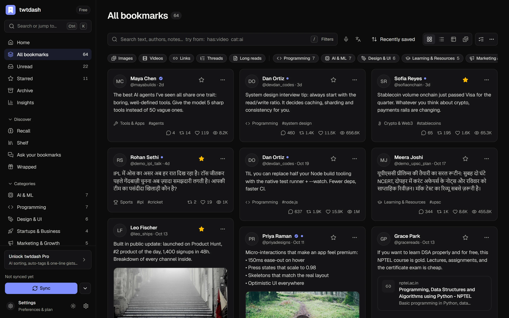
</picture>

</div>

<br />

## ✦ Why twtdash

X bookmarks become a junk drawer. They have no search worth using, no categories, no notes, and no way back to the thread you saved eight months ago. twtdash turns that pile into a personal library:

- **One click syncs everything.** No X API key, no paid developer plan, no account.
- **Every post is sorted automatically** into 17 categories, on your device, the moment it arrives.
- **Search finds anything as you type**, with operators like `from:` `cat:` `has:video` `after:30d` `min_likes:1k`.
- **Your library stays private.** It lives in your browser's IndexedDB and never touches a twtdash server.
- **It stays fast at 10,000+ posts** because the lists are virtualized, data streams in incrementally and the first screen paints in about a second. The [benchmarks](PERFORMANCE.md) have the numbers.

<br />

## ✦ Features

<table>
  <tr>
    <td width="50%" valign="top">
      <h3>⚡ One-click sync</h3>
      Opens your bookmarks page, auto-scrolls it, and reads the responses X already sends to your browser. <b>Quick sync</b> stops at posts you already have; <b>full sync</b> refreshes everything. It retries through rate limits and spots logged-out sessions. You can also import your <b>Likes</b>.
    </td>
    <td width="50%" valign="top">
      <h3>🔴 Real-time capture</h3>
      Bookmark or like a post anywhere on X and it lands in twtdash right away, with a toast to confirm. Removing a bookmark can remove it here too. X Premium <b>bookmark folders become collections</b>.
    </td>
  </tr>
  <tr>
    <td valign="top">
      <h3>🧠 On-device categorization</h3>
      17 built-in categories, scored from post text, link cards, quoted posts and linked domains. Ambiguous posts lean on what you usually save from that author. You can add keywords, create your own categories and re-sort at any time, and manual choices are never overwritten.
    </td>
    <td valign="top">
      <h3>✨ Optional Claude AI</h3>
      Claude picks categories, adds topical tags and writes one-line gists. You can <b>bring your own Anthropic key</b> (free; your browser talks to Anthropic directly) or use <b>twtdash Pro</b> (hosted, no key). The model is <code>claude-opus-5-5</code>, with structured JSON output.
    </td>
  </tr>
  <tr>
    <td valign="top">
      <h3>🗂️ Four layouts</h3>
      Masonry <b>grid</b>, dense <b>list</b>, <b>table</b> and a media <b>gallery</b>, all virtualized. A detail panel holds notes, tags, collections and more posts from the same author. Bulk actions, star, read/unread and archive are all here, with dark and light themes.
    </td>
    <td valign="top">
      <h3>🔎 Instant search with operators</h3>
      Search covers text, authors, notes, tags and link titles, and results update with every keystroke. You can combine operators, exact <code>"phrases"</code> and <code>-exclusions</code>. Press <kbd>Ctrl</kbd>/<kbd>⌘</kbd> <kbd>K</kbd> for a command palette that jumps to any post, category or screen.
    </td>
  </tr>
  <tr>
    <td valign="top">
      <h3>📊 Insights</h3>
      Saves over time (with a table view), your category mix, the authors you learn from most, content types, when you save and your most popular saves. Every panel follows one date-range filter.
    </td>
    <td valign="top">
      <h3>📤 Export and own your data</h3>
      Export <b>Markdown</b> grouped by category (works with Obsidian and Notion), Excel-safe UTF-8 <b>CSV</b>, or a full <b>JSON</b> backup you can merge back in on any device.
    </td>
  </tr>
</table>

<br />

## ✦ Screenshots

<table>
  <tr>
    <td width="50%">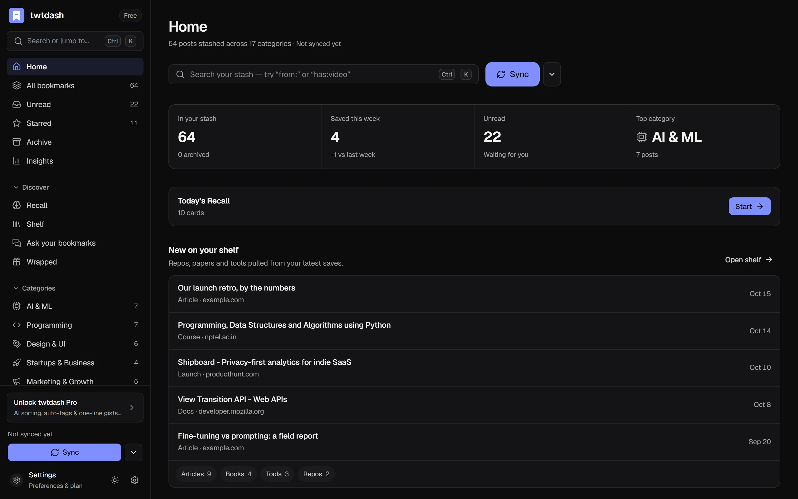<p align="center"><sub><b>Home</b>: what's new, what to rediscover, where your saves go</sub></p></td>
    <td width="50%">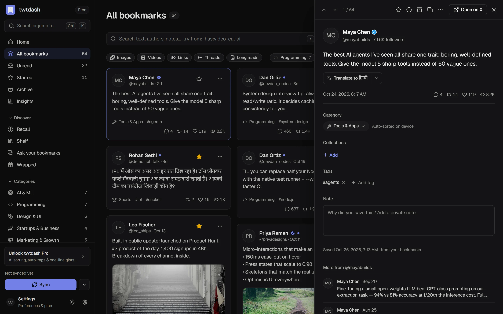<p align="center"><sub><b>Detail panel</b>: notes, tags, collections, more from the author</sub></p></td>
  </tr>
  <tr>
    <td>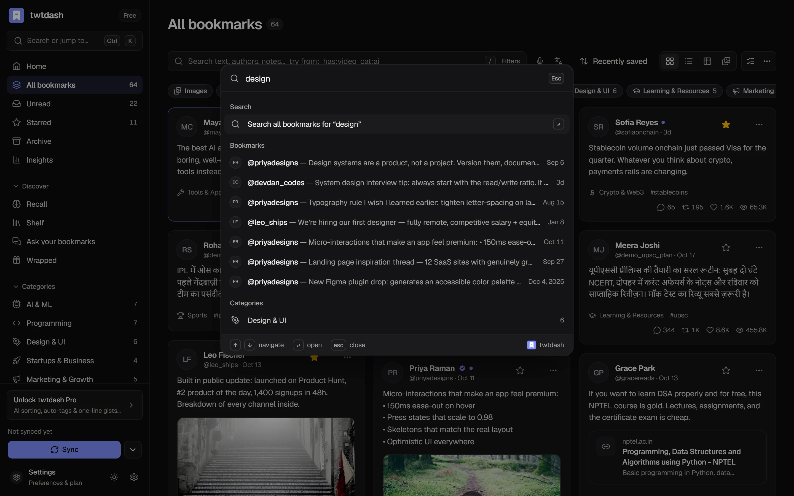<p align="center"><sub><b>Command palette</b>: <kbd>⌘K</kbd> to any post, category or screen</sub></p></td>
    <td>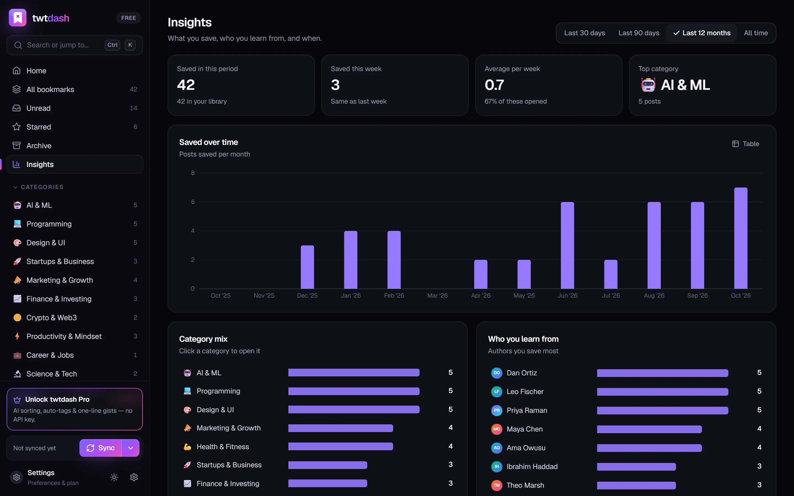<p align="center"><sub><b>Insights</b>: your reading habits, at a glance</sub></p></td>
  </tr>
  <tr>
    <td>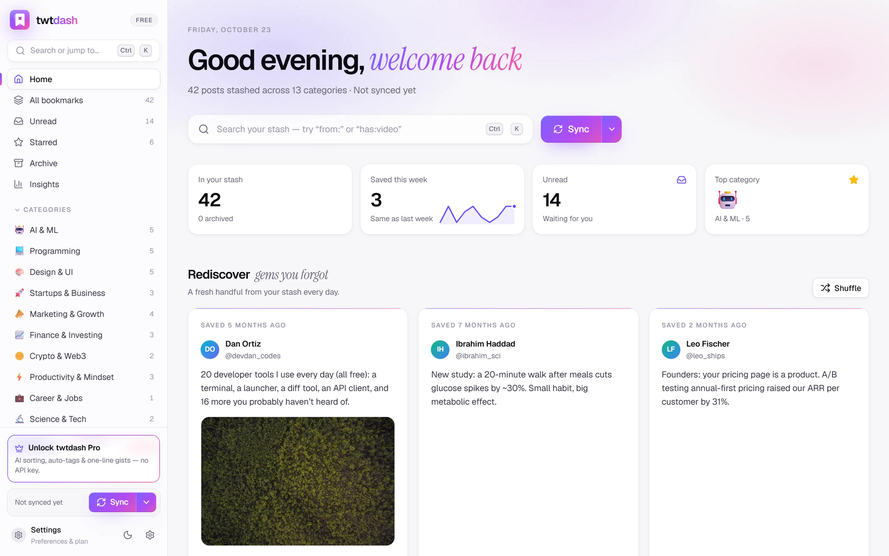<p align="center"><sub><b>Light theme</b>: follows your system, or pick one</sub></p></td>
    <td>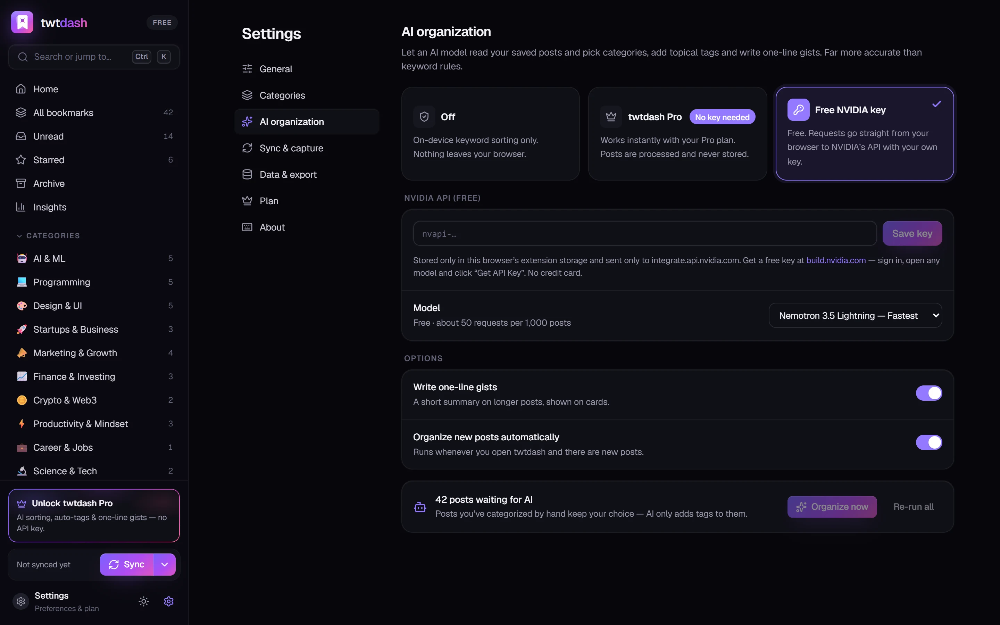<p align="center"><sub><b>AI settings</b>: your own key, or Pro with no key</sub></p></td>
  </tr>
  <tr>
    <td>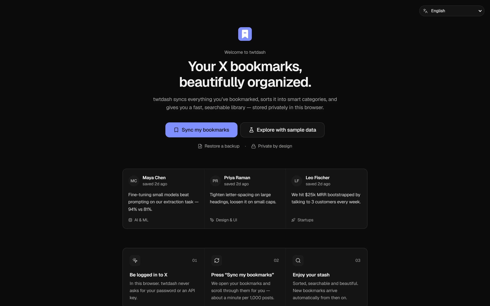<p align="center"><sub><b>Onboarding</b>: sync, or explore with sample data</sub></p></td>
    <td align="center">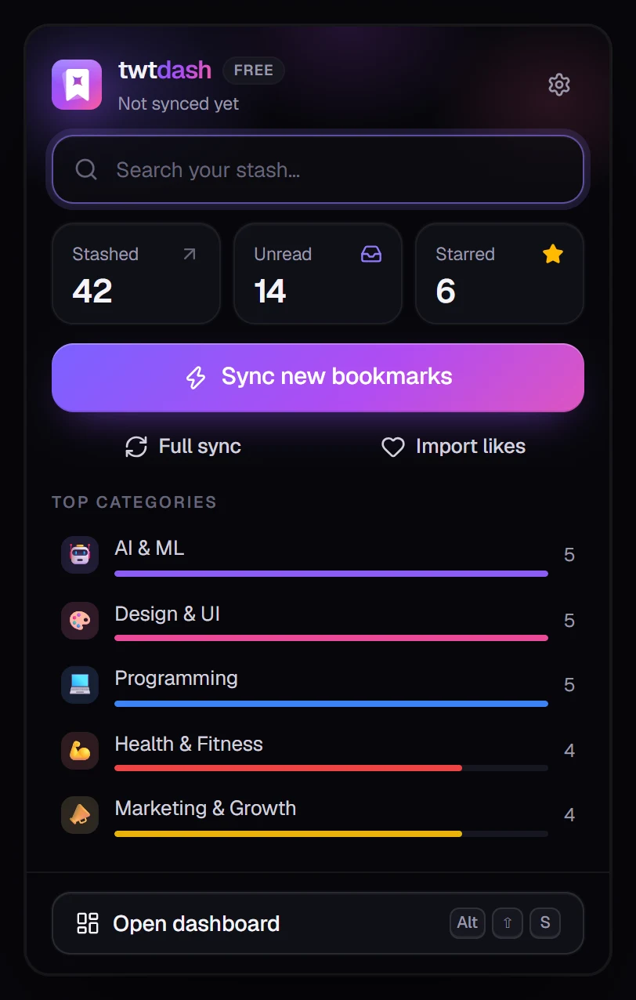<p align="center"><sub><b>Toolbar popup</b>: sync, search and stats in one click</sub></p></td>
  </tr>
</table>

<br />

## ✦ Install in 60 seconds

> **No X account handy?** Open the dashboard and click **Explore with sample data** to try everything on a fictional library.

### Chrome · Edge · Brave · Arc · Opera

1. Download [`twtdash-chrome.zip`](https://twtdash.vercel.app/downloads/twtdash-chrome.zip) and unzip it. Alternatively, clone this repo and use [`release/twtdash-extension/`](release/twtdash-extension).
2. Open `chrome://extensions` (or `edge://extensions` / `brave://extensions`) and turn on **Developer mode**.
3. Click **Load unpacked** and select the unzipped folder.
4. Pin **twtdash** from the puzzle-piece menu.
5. Log in to **x.com**, click the twtdash icon, then **Sync my bookmarks**. Keep the X tab visible while it scrolls; that takes about a minute per 1,000 bookmarks.

Press <kbd>Alt</kbd> + <kbd>Shift</kbd> + <kbd>S</kbd> to open the dashboard from anywhere.

### Firefox 128+

1. Download [`twtdash-firefox.zip`](https://twtdash.vercel.app/downloads/twtdash-firefox.zip) and unzip it.
2. Open `about:debugging#/runtime/this-firefox`, click **Load Temporary Add-on…**, and pick `manifest.json`.

Firefox removes temporary add-ons on restart. A permanent install needs the add-on published on [addons.mozilla.org](https://addons.mozilla.org); see [Publishing](#-publishing-to-the-stores).

<br />

## ✦ How sync works

twtdash never calls X on your behalf and never changes a request. It **reads the GraphQL responses that x.com already loads** while you look at your bookmarks, the same data your browser is rendering.

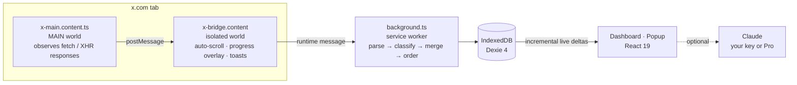

| Captured operation | What twtdash does with it |
|---|---|
| `Bookmarks`, `BookmarkFolderTimeline` | Imports posts, keeps your bookmark order, maps folders to collections |
| `CreateBookmark` / `DeleteBookmark` | Adds the post instantly, or removes it if mirroring is on |
| `Likes`, `FavoriteTweet` | Optional likes import and live capture |
| `BookmarkFoldersSlice` | Discovers your X Premium bookmark folders |

**It's built to survive X changes.**

- The [defensive parser](apps/extension/src/lib/parse.ts) handles both the current and legacy user schemas, plus visibility wrappers, tombstones, long-form note posts, quotes, retweets, cards, polls and articles. Unit tests cover it against fixtures.
- Bookmark order comes from decoding X's `sortIndex` snowflake (with plausibility checks), and falls back to the timeline order.
- When X renames something, only `parse.ts` and the operation names in `x-main.content.ts` need updating. Your saved library is never at risk.

<br />

## ✦ Search operators

| Operator | Example | Matches |
|---|---|---|
| `from:` | `from:mayabuilds` | Posts by an author (also `by:`) |
| `cat:` | `cat:ai` | A category (also `category:`) |
| `tag:` | `tag:agents` | A tag |
| `in:` | `in:"Read later"` | A collection |
| `has:` | `has:video` | `media` `image` `video` `gif` `link` `poll` `note` `summary` `tags` |
| `is:` | `is:thread` | `thread` `reply` `quote` `long` `article` `starred` `unread` `read` `archived` `liked` `ai` `uncategorized` |
| `after:` / `before:` | `after:30d` · `before:2026-01-01` | Saved in a date range (relative or absolute) |
| `min_likes:` / `min_views:` | `min_likes:1k` | Popularity thresholds |
| `domain:` | `domain:github.com` | Linked site (also `site:` / `url:`) |
| `lang:` | `lang:en` | Post language |
| `"…"` / `-` | `"system design" -crypto` | Exact phrase / exclude |

<details>
<summary><b>⌨️ Keyboard shortcuts</b></summary>
<br />

| Keys | Action | | Keys | Action |
|---|---|---|---|---|
| <kbd>⌘/Ctrl</kbd> <kbd>K</kbd> | Command palette | | <kbd>S</kbd> | Star / unstar |
| <kbd>/</kbd> | Search | | <kbd>R</kbd> | Mark read / unread |
| <kbd>J</kbd> / <kbd>K</kbd> | Next / previous post | | <kbd>E</kbd> | Archive |
| <kbd>↵</kbd> | Open details | | <kbd>X</kbd> | Select |
| <kbd>O</kbd> | Open on X | | <kbd>1</kbd>–<kbd>4</kbd> | Grid · List · Table · Gallery |
| <kbd>G</kbd> <kbd>H</kbd> / <kbd>A</kbd> / <kbd>U</kbd> / <kbd>I</kbd> | Home / All / Unread / Insights | | <kbd>Esc</kbd> | Close / clear selection |
| <kbd>Alt</kbd> <kbd>Shift</kbd> <kbd>S</kbd> | Open dashboard (global) | | <kbd>?</kbd> | Shortcut help |

</details>

<br />

## ✦ Performance

These benchmarks are production builds with a **10,000-post library** and **4× CPU throttling** (a mid-range laptop), median of 3 runs. Each fix was measured on its own before and after, and the fixes that didn't help were reverted. The method, stage-by-stage tables and trade-offs are in **[PERFORMANCE.md](PERFORMANCE.md)**.

| Metric | Before | After | |
|---|---:|---:|---|
| Startup → library on screen | 43.0 s | **12.9 s** | 3.3× faster |
| Reach the oldest post | never (> 60 s) | **3.3 s** | now possible |
| Popup open → counts | 30.3 s | **7.3 s** | 4.2× faster |
| Star a post → UI updated | 3.3 s | **1.1 s** | 3× faster |
| Switch → Library | 5.2 s | **2.9 s** | 1.8× faster |
| Search keystroke → results | 2.0 s | **1.3 s** | 1.5× faster |
| DOM nodes after scrolling | 4,731 | **1,811** | −62 % |
| JS heap | 55 MB | **26 MB** | −53 % |
| JS shipped | 1,648 KB | **1,157 KB** | −30 % |

**At full speed on a normal PC:** first content in **1.09 s**, star in **79 ms**, search at **108 ms** per keystroke, scrolling at **59.5 FPS** with zero janky frames, and a jump to the oldest of 10,000 posts in **81 ms**.

The biggest wins came from:

- replacing a full-text index build with lazy scan search;
- an incremental IndexedDB store (first 150 posts, then streamed pages, then `updatedAt` deltas);
- virtualized layouts;
- index-only counts;
- code-splitting the AI SDK and charts;
- swapping recharts for a small custom SVG chart.

<br />

## ✦ Architecture

```
twt/
├── apps/
│   ├── extension/            The product: WXT · React 19 · Tailwind v4 · Dexie (MV3, Chrome + Firefox)
│   │   ├── src/entrypoints/  background worker, x.com content scripts, dashboard, popup
│   │   ├── src/lib/          parser, classifier, query language, scan search, incremental store, AI, licensing
│   │   ├── src/components/   virtualized masonry/list/table/gallery, cards, detail panel, ⌘K palette
│   │   ├── src/views/        Home · Library · Insights · Settings · Welcome
│   │   ├── preview/          runs the UI in a normal tab with a fake extension API + 10k-post bench data
│   │   └── bench/            benchmark, CPU-profile/trace analysis, smoke test, README screenshots
│   └── web/                  Next.js 16: landing, install guide, privacy/terms, and the Pro API
├── packages/shared/          category taxonomy, Claude prompt + output parser, API contract, brand
├── release/                  prebuilt, ready-to-load extension + store zips
├── docs/screenshots/
├── PERFORMANCE.md            the performance investigation, with before/after numbers
└── STORE_LISTING.md          Chrome Web Store / AMO listing copy + permission justifications
```

| Layer | Stack |
|---|---|
| Extension framework | [WXT](https://wxt.dev) 0.21, Manifest V3 for Chrome and Firefox |
| UI | React 19, Tailwind CSS v4, Radix UI, cmdk, sonner, lucide, Geist + Instrument Serif |
| State and storage | Dexie 4 (IndexedDB) with compound indexes, zustand, an incremental live-delta store |
| Search | Custom operator parser + cached lowercase scan, warmed in idle time |
| AI | `@anthropic-ai/sdk`: Claude Opus 5.5, JSON-schema output, server-side fallback |
| Website and API | Next.js 16 on Vercel: `/api/health`, `/api/categorize`, `/api/license/{activate,validate}` |
| Billing | LemonSqueezy License API |
| Quality | Vitest (48 tests), TypeScript strict, a puppeteer smoke test (15 checks), a reproducible benchmark harness |

<br />

## ✦ Development

Requires **Node 20.9+** (22 recommended). Each app keeps its own lockfile, and `@twtdash/shared` is linked with `file:`.

```bash
npm run install:all      # install apps/extension and apps/web
npm run ext:dev          # launch Chrome with the extension + hot reload (ext:dev:firefox for Firefox)
npm run ext:preview      # dashboard in a normal tab with a fake extension API
                         #   http://localhost:5199/?demo    sample library
                         #   http://localhost:5199/?popup   toolbar popup
                         #   http://localhost:5199/?bench=10000   synthetic 10k-post library
npm run ext:test         # 48 unit tests: parser, categorizer, query language, search, ingest
npm run ext:typecheck
npm run ext:zip          # Chrome + Firefox zips (+ Firefox sources zip) in apps/extension/.output
npm run web:dev          # website + API on http://localhost:3000
npm run release          # test → zip → copy zips into apps/web/public/downloads → build site
```

<details>
<summary><b>Benchmarks, profiling and screenshots</b></summary>
<br />

All of these use your installed Chrome through `puppeteer-core`:

```bash
cd apps/extension
node bench/run.mjs my-change --runs 3 --cpu 4   # full benchmark → bench/results/<label>.json
node bench/summary.mjs                          # before/after table across stages
node bench/smoke.mjs                            # 15 end-to-end interaction checks
node bench/profile.mjs                          # CPU profile of startup
node bench/trace.mjs --nav                      # performance trace of screen switches
node bench/screenshots.mjs                      # regenerate docs/screenshots/*.webp
```

</details>

<br />

## ✦ twtdash Pro and the hosted API

Free includes everything except hosted AI. **Pro** ($5/mo or $48/yr; prices live in [`packages/shared/src/brand.ts`](packages/shared/src/brand.ts)) adds Claude categorization, auto-tags and gists without an API key.

1. Create a product in **LemonSqueezy** with license keys enabled.
2. Deploy `apps/web` to Vercel with **root directory `apps/web`**, and set these environment variables:

   | Variable | Purpose |
   |---|---|
   | `ANTHROPIC_API_KEY` | Required for `/api/categorize` |
   | `TWTDASH_AI_MODEL` | Optional. Defaults to `claude-opus-5-5`; `claude-haiku-5-5` costs about 40× less at volume |
   | `LEMONSQUEEZY_STORE_ID` | Rejects license keys from other stores |
   | `LEMONSQUEEZY_PRODUCT_IDS` | Optional comma-separated product allow-list |
   | `NEXT_PUBLIC_CHECKOUT_URL` | Your LemonSqueezy checkout link |
   | `NEXT_PUBLIC_CHROME_STORE_URL` / `NEXT_PUBLIC_FIREFOX_ADDON_URL` | Store buttons, once you're listed |
   | `NEXT_PUBLIC_SITE_URL` | Canonical URL for metadata and OG images |

3. Build the extension against your deployment with `WXT_API_BASE=https://your-domain` (see [`apps/extension/.env.example`](apps/extension/.env.example)).
4. Customers paste their license key in **Settings → Plan**. The extension activates it through `/api/license/activate`, then calls `/api/categorize` with the key and its instance id.

`GET /api/health` reports whether AI and licensing are configured. Rate limits are in-memory per server instance, so move them to Upstash or Redis before you scale.

**To test Pro end to end locally:**

1. Set `TWTDASH_DEV_LICENSE=dev-key` and `ANTHROPIC_API_KEY` in `apps/web/.env.local`.
2. Run `npm run web:dev`.
3. Build the extension with `WXT_API_BASE=http://localhost:3000`.
4. Activate the license key `dev-key`.

More detail is in [`apps/web/README.md`](apps/web/README.md).

<br />

## ✦ Publishing to the stores

- [ ] Replace the placeholder domain and emails in [`packages/shared/src/brand.ts`](packages/shared/src/brand.ts). The stores require the privacy policy the site serves at `/privacy`.
- [ ] **Chrome Web Store:** upload `twtdash-extension-*-chrome.zip`, and copy the listing text and permission justifications from [`STORE_LISTING.md`](STORE_LISTING.md).
- [ ] **Firefox AMO:** upload the Firefox zip together with the generated sources zip.
- [ ] Set `NEXT_PUBLIC_CHROME_STORE_URL` / `NEXT_PUBLIC_FIREFOX_ADDON_URL` so the site's install buttons point to the listings.

<br />

## ✦ Privacy and permissions

| Permission | Why |
|---|---|
| `storage`, `unlimitedStorage` | Your library is stored locally in IndexedDB; large libraries need more than the default quota |
| `x.com`, `twitter.com` | Reads the bookmark data X loads in your own tab; never sends requests on your behalf |
| `api.anthropic.com` *(optional)* | Requested only when you add your own Anthropic key |

There are no analytics, no trackers and no remote code. Nothing leaves your browser unless you turn on AI, and then only the post content needed to categorize it (text, author, link titles) goes to Anthropic or the Pro API.

<br />

## ✦ Known limitations

- Sync depends on **X's private web API**, which can change without notice. The parser is defensive, and the code that would need updating is isolated to a few files.
- Search uses substring and prefix matching, not typo-tolerant fuzzy matching. That trade-off is what makes a 10,000-post library start 3.3× faster.
- The Firefox build loads as a temporary add-on until it's published on AMO.

<br />

<div align="center">

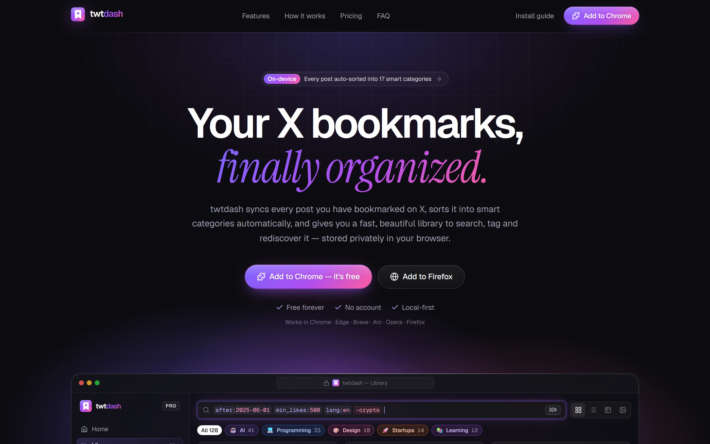

<br />
<br />

**[twtdash.vercel.app](https://twtdash.vercel.app)**

<sub>twtdash is an independent project and is not affiliated with, endorsed by, or sponsored by X Corp. "X" and "Twitter" are trademarks of X Corp.</sub>

<sub>© 2026 twtdash. All rights reserved.</sub>

</div>
